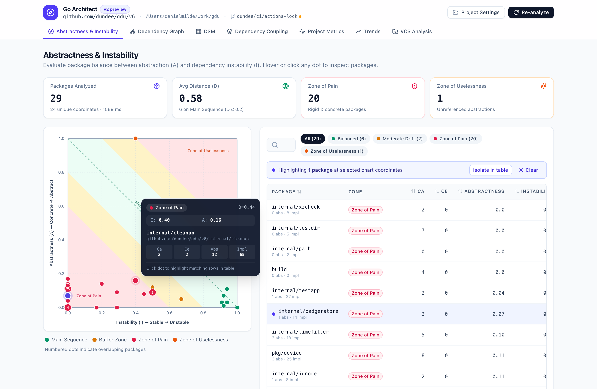
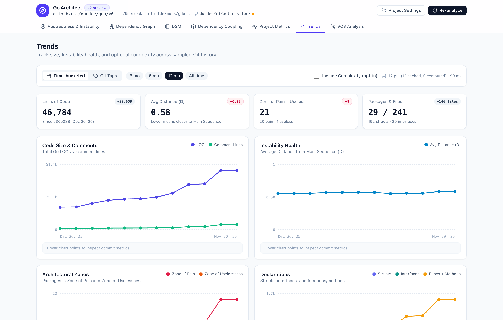

# Go-Architect

<div align="center">

</div>

<p align="center">
  <a href="https://github.com/dundee/go-architect/actions/workflows/build.yml"></a>
  <a href="https://go.dev/"></a>
  <a href="./LICENSE"></a>
</p>

Go-Architect is an interactive Software Architecture Analysis Tool for Go Projects. Run a single binary from the command line against any local Go module to explore architectural metrics, dependency structures, complexity, and Git-backed trends in your browser.

---

## Features
- **Abstractness & Instability Chart**: Interactive scatter plot with Main Sequence, Zone of Pain, Zone of Uselessness, overlapping package grouping, hover tooltips, and synced table filtering.
- **Dependency Graph**: Directed graph across Package Layers (`internal`, `organization`, `external`, `standard`) with neighbor inspection and direct jump to Coupling.
- **Dependency Structure Matrix (DSM)**: Package-to-package and 4×4 layer-aggregated matrices with weighted/boolean modes, mutual Dependency Cycle detection, optional test-file inclusion, and Graph Density metrics (Propagation Cost, Max Dependency Depth, and Tarjan SCC cycle count).
- **Dependency Coupling**: Inspect how deeply your Project depends on any imported package down to highlighted Go source lines (with optional test-file inclusion).
- **Project Metrics**: Production-only LOC, declaration/visibility counts, interface sizing, comment ratios, exported API doc coverage, function length & parameter metrics, built-in Cyclomatic/Cognitive complexity (in-process, zero external binaries required), plus a dedicated Test Metrics section (test LOC/files/functions and tested vs. untested production packages). Generated Go files matching Go's standard header (`// Code generated ... DO NOT EDIT.`, including generated `*_test.go` files) are automatically excluded from all code, test, and complexity metrics (note that live dependency views—Instability, Dependency Graph, DSM, and Coupling—still include generated files).
- **Trends**: Historical metric trends sampled from Git commits/tags with local per-commit Protobuf caching and live SSE progress streaming—tracking size, Instability health, Cyclomatic/Cognitive complexity, doc coverage, test coverage, Propagation Cost, and Max Dependency Depth (generated `// Code generated ... DO NOT EDIT.` files are excluded from all snapshot metrics).
- **VCS Analysis**: Contributor activity, Bus Factor Risk, and Churn × Complexity Hotspots across the Repository over configurable time windows (Hotspots exclude generated `// Code generated ... DO NOT EDIT.` files, while Git modification counts/Bus Factor Risk reflect full commit history).
- **In-App Project Switcher & Cache**: Switch target Go Projects and organization prefixes directly from the web UI without restarting, backed by a per-commit Protobuf cache in your OS user cache directory (`go-architect/v4`).

## Screenshots

### Abstractness & Instability Chart


### Dependency Graph


### Historical Metric Trends


## Installation

### Requirements
- Go 1.27+

### Install with Go
```bash
go install github.com/dundee/go-architect@latest
```

### Build from Source
```bash
git clone https://github.com/dundee/go-architect
cd go-architect
make build
```

## Usage
```bash
# Analyze the current directory and open the web UI
go-architect .

# Or run directly from source
go run . .

# Specify organization package prefixes and custom listen address
go-architect -path /path/to/repo -org github.com/my-org/ -addr 127.0.0.1:8080

# Start without auto-opening the browser
go-architect -open=false /path/to/repo
```

## Development
```bash
# 1. Start the Go API server
go run . -open=false -path .

# 2. Start Vite dev server (proxies /api to 127.0.0.1:8080)
cd web && npm install && npm run dev

# 3. Rebuild embedded frontend assets
make web-build

# 4. Run Go tests, vet, and lint
make test
make vet
make lint

# 5. Install the binary with embedded frontend
make install
```

## Acknowledgements

Originally created by [Francisco Daines](https://github.com/go-architect/go-architect) as a Wails desktop application; reworked into a CLI + embedded React/TypeScript web UI with expanded interactive visualizations and Git-computed historical trends.
